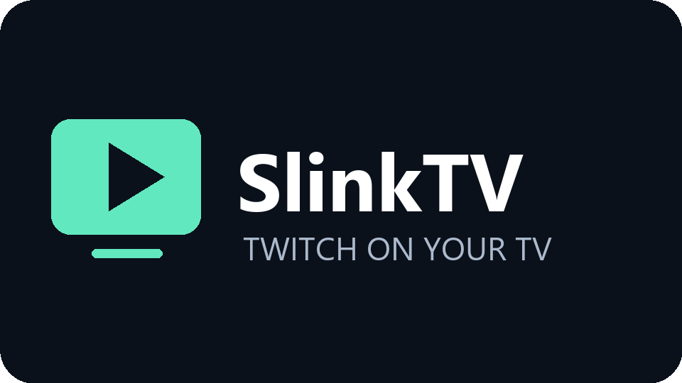

<p align="center">
  
</p>

SlinkTV is a Twitch player for Android TV 14 and newer. It runs [Streamlink](https://github.com/streamlink/streamlink) inside the app to resolve streams and plays them with AndroidX Media3. You don't need a server or any other app on the TV.

## Features

- **Live streams:** browse followed or popular streams, search, and pick a quality.
- **Phone login:** scan a QR code on the TV with your phone to sign in to Twitch.
- **Videos:** past broadcasts from followed channels, with resume and fast seeking.
- **Chat:** read-only live chat with Twitch and 7TV emotes, shown beside or over the video.
- **Optional ad-free proxy:** route the stream playlist through community servers, as Xtra does (off by default). If Twitch still inserts an ad, the player shows a backup stream until the break ends, as Xtra does, or hides and mutes the ad.
- **Remote-friendly:** every screen works with a D-pad.
- **Self-updating:** the app installs new versions from GitHub Releases, with Stable and Preview channels.

## Install

1. On the TV, install **Downloader** from the Play Store.
2. In Downloader, open `https://github.com/krabilousse/slinktv/releases/latest/download/SlinkTV.apk`.
3. Allow Downloader to install unknown apps when Android asks, then install.
4. Open **SlinkTV**, then select **Sign in** to log in with your phone.

The app checks for updates when it opens. You can also check from **Settings → App updates**.

With ADB: `adb install -r SlinkTV.apk`

## Notes

- The app is not affiliated with Twitch. Guest browsing uses Twitch's unofficial web API, which can change.
- Ads play normally unless the ad-free proxy is on. Subscriber-only streams are not supported.
- Third-party licenses are listed in the app under **Licenses**.

## Development

Building needs JDK 17, Android SDK 36 and Python 3.11. On Windows:

```powershell
python scripts/bootstrap.py
powershell -ExecutionPolicy Bypass -File scripts/setup-sdk.ps1
powershell -ExecutionPolicy Bypass -File scripts/build.ps1
```

[docs/releases.md](docs/releases.md) covers how to release and how update channels work. [CHANGELOG.md](CHANGELOG.md) lists changes.
